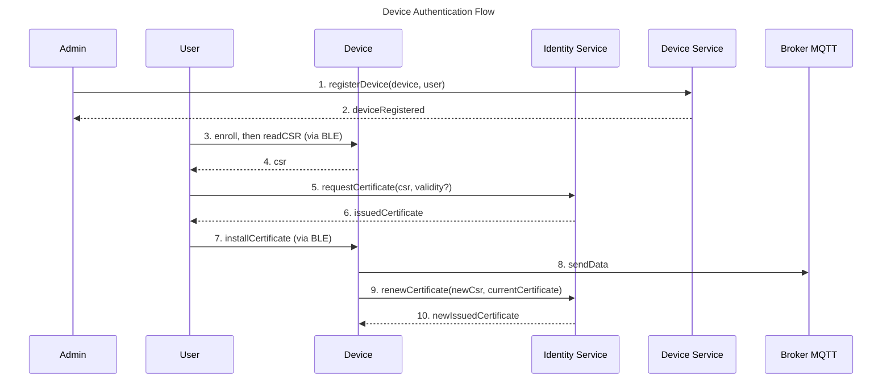

# Device Authentication Overview

Devices are an important part of the vehicle tracking system. They are responsible for sending the location data to the server, which is then used to track the vehicle. To ensure that only authorized devices can send data to the server, we need to implement device authentication.

The devices send their data to the MQTT broker, which is responsible for authenticating the devices before allowing them to publish their data. This is possible by verifying if the certificate provided by the device is valid and has been issued by a trusted certificate authority (CA). The CA is responsible for issuing certificates to the devices, which can be used for authentication.

The system designed for device authentication is called the **Identity Service**. The Identity Service is responsible for issuing and managing the certificates for the devices. We will talk more about the Identity Service in the [Identity Service](../../../identity-service/overview.md) section.

The device authentication process can be summarized in the following steps:

1. The administrator registers the device in the system and assigns it to a user.
2. The user connects to the device via BLE and starts the enrollment, which makes the device generate a key pair and a CSR (Certificate Signing Request) and enter the `ENROLLING` state. The user then reads the CSR.
3. The user submits the CSR to the Identity Service, optionally choosing the validity of the certificate. The Identity Service trusts the request because the device is assigned to the user.
4. The Identity Service signs the CSR, issues a certificate for the device, and returns it to the user.
5. The user installs the certificate on the device via BLE, and the device becomes `ACTIVE`.
6. The device uses the certificate to authenticate with the MQTT broker and publish its data.
7. When the renewal window is reached, the device creates a new CSR and renews the certificate directly with the Identity Service, authenticating with its current certificate.

The states the device goes through, and the transitions between them, are described in the [Lifecycle](../lifecycle.md).

The following diagram illustrates the device authentication process:

There are some important points to note about the device authentication process:

- The CSR is generated by the device and contains the device's public key. The corresponding private key never leaves the device, ensuring that the certificate is bound to the specific device hardware.
- The Identity Service cannot trust the device, because it has no credentials yet, but it can trust the user. That is why the user submits the CSR, and why the device is registered and assigned to that user beforehand.
- The Identity Service supports certificate renewal. Before a certificate expires, the device requests a new one directly from the Identity Service, which trusts it because of its current certificate, ensuring uninterrupted authentication with the MQTT broker. If the certificate expires before the renewal succeeds, the device can no longer renew it and the user must enroll the device again.
- What if the private key of the device is compromised? The user must revoke the device's credentials in two places: on the device via BLE, which wipes the private key along with the CSR and the certificate, and on the Identity Service, which revokes the certificate. The device is then `REVOKED` and the user can enroll it again, with a new key pair and a new certificate. More details are covered in the [Credentials](./credentials.md) document.

Summarizing, device authentication is a crucial aspect of the vehicle tracking system to ensure that only authorized devices can send data to the server. The Identity Service plays a key role in managing the certificates for the devices and ensuring secure authentication with the MQTT broker. You can find more details about the Identity Service in the [Identity Service](../../../identity-service/overview.md) section.
