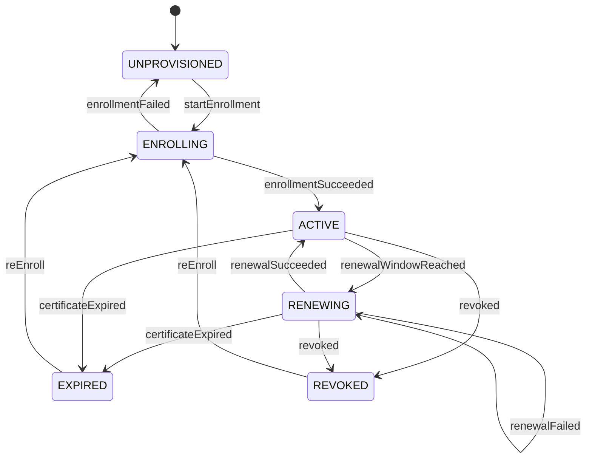

# Lifecycle

The device security lifecycle is designed to ensure that the device has credentials that are valid and trusted by the services it interacts with. The lifecycle includes the following states:

1. **UNPROVISIONED**: The device has no certificate stored. It cannot authenticate with other services.

2. **ENROLLING**: The device has generated its CSR and is waiting for the user to install the certificate issued by the Identity Service.

3. **ACTIVE**: The device has a valid certificate. It can authenticate with other services.

4. **RENEWING**: The device has requested a new certificate from the Identity Service and is waiting for the result. The current certificate is still valid.

5. **EXPIRED**: The device's certificate has expired before the renewal succeeded. It cannot authenticate with other services, and it cannot renew either, so it must be enrolled again.

6. **REVOKED**: The device's certificate has been revoked, either due to security concerns or because the device is no longer trusted. It cannot authenticate with other services.

The following state machine diagram illustrates the transitions between these states:

The device saves its current state in flash, so it survives reboots. The state is what decides what the device allows, such as when it creates a new CSR. A revoke on the device wipes its credentials and saves `REVOKED`. A revocation on the Identity Service does not reach the device, which only finds out when it can no longer authenticate.

If the user installs an invalid certificate while the device is `ENROLLING`, the enrollment fails and the device goes back to `UNPROVISIONED`.

The device moves to `EXPIRED` when it reads its certificate and finds that it has expired.

A revoked device does not recover on its own. The user must start re-enrollment, which discards the revoked credentials and goes straight to `ENROLLING`.
