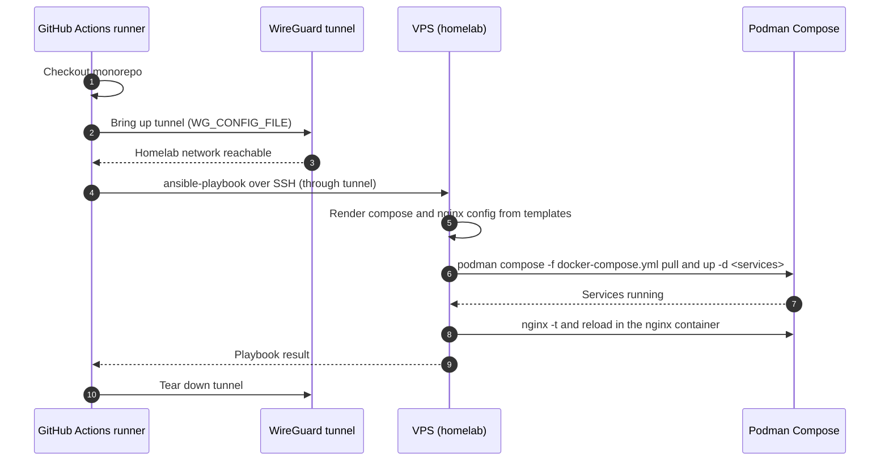

# Infrastructure Automation Research

As the vehicle tracker grows, each new service means more hand-edited infrastructure config: compose definitions, nginx routes, environment variables and deploy steps. Keeping these in sync by hand is slow and error-prone.

This document researches how to automate that configuration in `vehicle-tracker-infrastructure`. The chosen direction is to define services with Podman Compose and deploy them to a VPS with Ansible. The VPS is hosted in a homelab, so deployments from CI reach it through a WireGuard tunnel, as the existing workflows do. The sections below describe the current state, the proposed design, the alternatives considered and a recommendation, to be agreed before implementation starts.

## 1. Context and Goals

- Why hand-maintained infra config does not scale as services grow.
- Goals (e.g. one source of truth per service, reproducible deploys, no manual edits on the VPS).
- Non-goals (e.g. Kubernetes, multi-host orchestration).

## 2. Decided Direction

- **Podman Compose** defines the services.
- **Ansible** deploys them to the VPS.
- The VPS runs in the homelab, so CI must reach it through a **WireGuard** tunnel, as `build-push-backend.yml` already does.

## 3. Target Architecture

### 3.1 Deployment flow
Ansible runs inside a GitHub Actions job. The job first brings up a WireGuard tunnel to the homelab, then Ansible connects to the VPS over SSH through that tunnel and applies the configuration with Podman Compose.



### 3.2 Repository layout
`vehicle-tracker-infrastructure` is a folder in the monorepo. GitHub only reads workflows from the root `.github/workflows/`, so the deploy workflow lives there, next to the existing ones, and runs Ansible from the infra folder.

```text
.github/
└── workflows/
    └── deploy-infrastructure.yml   # WireGuard up → ansible-playbook → WireGuard down
```

Inside the monorepo, the infra folder is structured as:

```text
vehicle-tracker-infrastructure/
├── ansible/
│   ├── ansible.cfg
│   ├── requirements.yml            # Ansible collections (e.g. containers.podman)
│   ├── inventory/
│   │   └── production/
│   │       ├── hosts.yml           # VPS address and SSH user
│   │       └── group_vars/
│   │           └── all.yml         # Service list: the single source of truth
│   ├── playbooks/
│   │   ├── site.yml                # Runs every role
│   │   └── deploy.yml              # Only renders config and updates services
│   └── roles/
│       ├── common/                 # Base packages, users, firewall
│       ├── podman/                 # Podman and compose provider
│       └── app/
│           ├── tasks/main.yml      # Template files, validate nginx, podman compose -f docker-compose.yml up -d <services>
│           ├── handlers/main.yml   # Reload nginx container, restart changed services
│           └── templates/
│               ├── compose.yml.j2  # All services, including the nginx container
│               ├── env.j2          # Per-service environment files
│               ├── nginx.conf.j2   # Mounted into the nginx container
│               └── service.conf.j2 # One server/location block per service
├── docs/
│   └── ...                         # Runbooks and operational notes
└── README.md
```

#### File descriptions

**Workflow**

- `.github/workflows/deploy-infrastructure.yml`: the GitHub Actions workflow that deploys the infrastructure. It brings up the WireGuard tunnel with `WG_CONFIG_FILE`, loads the SSH key, exports the application secrets from GitHub Secrets as environment variables, runs `ansible-playbook playbooks/deploy.yml` with `working-directory: vehicle-tracker-infrastructure/ansible`, and tears the tunnel down. It runs on two kinds of change: changes in `vehicle-tracker-infrastructure/**` (config only, all services re-rendered) and backend changes (it runs after the backend build workflow succeeds and deploys only the services that changed, see [CI/CD Integration](#5-cicd-integration)). It lives at the monorepo root because GitHub only reads workflows from there.

**Ansible configuration**

- `ansible/ansible.cfg`: project-wide Ansible settings, such as the default inventory path, the roles path, the SSH options and disabling host key prompts for the known VPS.
- `ansible/requirements.yml`: the Ansible collections the playbooks need, such as `containers.podman`. The workflow installs them with `ansible-galaxy collection install -r requirements.yml`.

**Inventory**

- `ansible/inventory/production/hosts.yml`: the list of managed hosts. It holds the VPS address (reachable through WireGuard), the SSH user and the SSH port. There is a single `production` inventory. If another environment is needed later, add a sibling directory that reuses the same roles.
- `ansible/inventory/production/group_vars/all.yml`: the non-secret variables and the **service list**, the single source of truth. Each entry describes a service (name, image, port, public route). The compose file and the nginx config are both rendered from it, so adding a service means adding one entry. Secrets are not stored here: it references them with `lookup('env', 'NAME')`, and the values come from GitHub Secrets.

**Playbooks**

- `ansible/playbooks/site.yml`: the full provisioning playbook. It runs `common`, `podman` and `app` in order and takes a bare VPS to a running system. Run it for a new or rebuilt host, or when host-level setup changes.
- `ansible/playbooks/deploy.yml`: the fast playbook CI runs on every release. It only runs the `app` role: it renders the config, pulls the images and updates the containers.

**Roles**

- `ansible/roles/common/`: base host setup. It handles package updates, essential tools, the deploy user, SSH hardening and the firewall. It runs once per host and rarely changes.
- `ansible/roles/podman/`: installs Podman and a compose provider, enables the Podman socket for the deploy user and installs the Harbor CA so the host can pull images. It runs once per host and rarely changes.
- `ansible/roles/app/tasks/main.yml`: the deploy steps. It renders the templates onto the VPS, validates the nginx config, runs `podman compose -f docker-compose.yml pull <services>` and `podman compose -f docker-compose.yml up -d <services>`, where `<services>` are the services being deployed.
- `ansible/roles/app/handlers/main.yml`: actions triggered only when a file changed. It reloads the nginx container and restarts services whose env file changed.
- `ansible/roles/app/templates/docker-compose.yml.j2`: the compose file for every service, including the nginx container. nginx is a service in the compose file, not installed on the host, so the host only needs Docker.
- `ansible/roles/app/templates/env.j2`: the environment file rendered for each service, with secrets read from environment variables (`lookup('env', ...)`) that the workflow exports from GitHub Secrets.
- `ansible/roles/app/templates/nginx.conf.j2`: the global nginx configuration, mounted into the nginx container.
- `ansible/roles/app/templates/service.conf.j2`: the nginx server/location block, rendered once per entry in the service list.

**Documentation**

- `docs/`: documentation for this project, including this research document and later runbooks and operational notes.
- `README.md`: how to use the project: required tools, the list of GitHub Secrets, and how to run the playbooks manually.

## 4. Podman Compose

Podman Compose describes every container of the system in one place. Ansible renders the compose file onto the VPS from `docker-compose.yml.j2` and runs it, so the file is generated from the service list in `group_vars/all.yml` instead of being edited by hand.

### 4.1 What runs in the stack

| Group | Containers | Source |
|---|---|---|
| Edge | `nginx` (reverse proxy, the only container with published ports) | Public image |
| Application | `api-gateway`, `identity-service`, `asset-service`, `ingestion-service` | Images built by CI and pushed to Harbor (`registry.homelab/vehicle-tracker/<service>`) |
| Data and messaging | `postgres` (TimescaleDB), `kafka`, and `mosquitto` (MQTT broker) | Public images, with data on named volumes |

### 4.2 One compose file, rendered by Ansible

- **Decision:** a single `docker-compose.yml` for production, rendered from the template. There are no override files, because there is only one environment (`production`).
- **Why a template:** the application services are the same shape (image, env file, network, healthcheck, restart policy). The template loops over the service list, so adding a service means adding one entry to `all.yml`, and the compose block is generated.
- **Static parts:** the data and messaging containers and the nginx container are written directly in the template, because they rarely change.
- **Local development stays separate:** the existing `vehicle-tracker-backend/compose/docker-compose.yml` is for running dependencies locally. The production file is not meant to be used on a developer machine.

### 4.3 Service definition

Each application service gets a block with the same fields, filled from its entry in the service list:

```yaml

  {{ service.name }}:
    image: {{ registry }}/vehicle-tracker/{{ service.name }}:${ {{- service.tag_var -}} }
    restart: unless-stopped
    env_file: ./env/{{ service.name }}.env
    networks: [backend]
    healthcheck:
      test: ["CMD", "curl", "-f", "http://localhost:{{ service.port }}/actuator/health"]
      interval: 30s
      timeout: 5s
      retries: 3
    depends_on:
      postgres:
        condition: service_healthy

```

`tag_var` is the name of the tag variable for that service (for example `ASSET_SERVICE_TAG`). The healthcheck path is an assumption. Confirm each service exposes a health endpoint, and that the image contains the tool used to call it.

### 4.4 Image tags and versions

- Each service image is referenced as `<registry>/vehicle-tracker/<service>:${<SERVICE>_TAG}`.
- The tags are kept in a `.env` file on the VPS. A deploy updates only the tags of the services that changed, so the others keep their current version. This is the option evaluated in [section 5.3](#53-keeping-the-other-services-on-their-current-version).
- The third-party images (`postgres`, `kafka`, `mosquitto`, `nginx`) are pinned to an exact version in `all.yml`, never `latest`, so a deploy cannot upgrade a database by accident.

### 4.5 Configuration and secrets

- Each service reads its environment from `env/<service>.env`, rendered from `env.j2`.
- Secrets come from GitHub Secrets through `lookup('env', ...)`. The env files are written with mode `0600`, owned by the deploy user, and the task uses `no_log: true`.
- Compose files and env files must not contain secrets that were not rendered by Ansible. The repository never holds them.

### 4.6 Networking

- A single bridge network, `backend`, connects all containers. Containers reach each other by service name (for example `postgres:5432`).
- Only `nginx` publishes ports (80 and 443), plus the MQTT port if devices connect directly to the broker. The application services and databases use `expose` or no ports at all, so they are not reachable from outside the host.
- Podman publishes ports through its own network backend, so check how the published ports interact with the host firewall (`ufw`) and open only what is needed.

### 4.7 Volumes and persistence

- `postgres`, `kafka` and `mosquitto` use **named volumes**, so data survives container recreation and `podman compose -f docker-compose.yml up -d`.
- The nginx config is mounted read-only from the host path where Ansible renders it, and the TLS certificates from their own path.
- Backups of the Postgres volume are out of scope for this document, but must be solved before production use.

### 4.8 Healthchecks, startup order and restarts

- Every container defines a `healthcheck`. `depends_on` with `condition: service_healthy` makes the application services wait for `postgres` and `kafka`, so a deploy does not start them against a database that is not ready.
- All containers use `restart: unless-stopped`, so they come back after a reboot of the VPS.
- `podman compose -f docker-compose.yml up -d <services>` only recreates containers whose image or configuration changed. After it, the deploy waits for the changed services to become healthy and fails the playbook if they do not.

### 4.9 Validation

- `podman compose -f docker-compose.yml config` runs in CI against the rendered file to catch syntax and variable errors before anything reaches the VPS.
- `ansible-lint` and the template rendering run in a dry run (`--check --diff`) on pull requests that touch the infrastructure folder.

## 5. CI/CD Integration

### 5.1 Triggers

- **Backend change** (`vehicle-tracker-backend/**` on `main`): the build workflow builds and pushes the images of the services that changed to Harbor. When it finishes successfully, the deploy workflow starts and deploys only those services.
- **Infrastructure change** (`vehicle-tracker-infrastructure/**` on `main`): re-render the config and apply it. No image is built.
- **Manual dispatch**: deploy a chosen set of services, or all of them.

### 5.2 Deploying only the services that changed

Today `build-push-backend.yml` builds and pushes all four images on any backend change, tagging each with the first 10 characters of the commit SHA and `latest`. To deploy only what changed:

1. **Detect changes per service** (in the build workflow). A first job (for example with `dorny/paths-filter`) maps changed paths to services: `vehicle-tracker-backend/asset-service/**` → `asset-service`, and so on. Shared modules (`api-common`, `error-common`, `events`, `schema`, `gradle`, `settings.gradle.kts`) map to **all** services, since every service depends on them.
2. **Build and push only those images** (a matrix over the changed services), reusing each `buildAndPushContainer.sh`. At the end, the workflow uploads an artifact with the list of changed services and the image tag.
3. **Deploy in a separate workflow, after the images are on Harbor.** `deploy-infrastructure.yml` is a new workflow that triggers with `workflow_run` on the build workflow (`types: [completed]`) and only continues when its conclusion is `success`. It downloads the artifact from the triggering run, so it knows which services to deploy and which tag to use. It checks out the commit that was built (`github.event.workflow_run.head_sha`), because `workflow_run` otherwise uses the default branch.
4. **Run Ansible with the changed services.** The deploy workflow passes the services and the image tag to Ansible as extra variables, and the `app` role runs `podman compose -f docker-compose.yml pull <services>` and `podman compose -f docker-compose.yml up -d <services>`. Untouched containers are not recreated.
5. **One deploy at a time** (`concurrency`), so two quick merges to `main` cannot deploy in parallel.

The build and the deploy are two workflows on purpose: the deploy only starts when every image is already on Harbor, and a failed build never reaches the VPS. The WireGuard and Ansible steps live only in the deploy workflow. The same workflow also handles the infrastructure-change and manual triggers from 5.1 through its own `push` and `workflow_dispatch` triggers.

### 5.3 Keeping the other services on their current version

The compose file is rendered as a whole, so a service that did not change still needs a tag. Options:

- **Tag file on the VPS (recommended to evaluate):** the compose file references `image: ...:${ASSET_SERVICE_TAG}`, and the tags live in a `.env` file on the VPS. A deploy updates only the tags of the changed services, so the rest stay as they are.
- **Tag in `all.yml`:** CI commits the new tag to the repo. It gives a full history of what ran, but adds a commit per deploy.
- **`latest` for everything:** the simplest option, but there is no record of the running version and no easy rollback.

This is an open question to decide before implementation.

### 5.4 Other checks

- Job steps: checkout → WireGuard → Ansible deploy → smoke test.
- Linting and checks (`ansible-lint`, `podman compose -f docker-compose.yml config`, `nginx -t`).
- Concurrency control and environment protection.

## References

- `.github/workflows/build-push-backend.yml`
- [Ansible](https://docs.ansible.com/)
- [Compose](https://podman-desktop.io/docs/compose)
